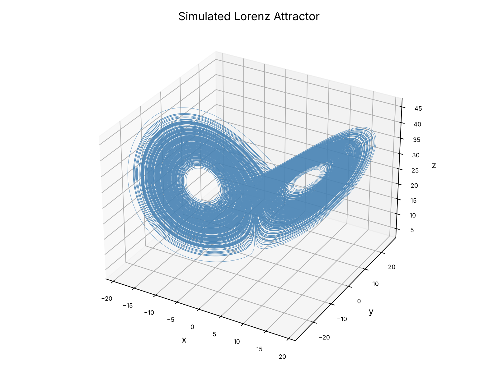
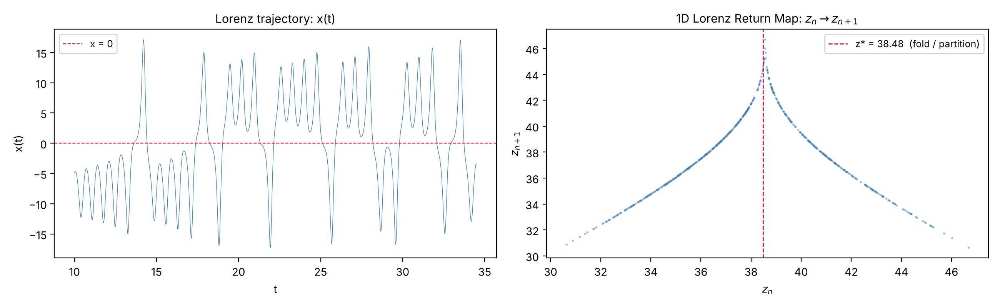

# Periodic Orbit Detection in the Lorenz Attractor

A five-stage Python pipeline that detects and encodes unstable periodic orbits in the chaotic Lorenz system using symbolic dynamics and kneading theory.

This is the code for my B.Sc. thesis in Computer Science at Constructor University Bremen (May 2026), *"An Algorithm for Detecting and Encoding Periodic Orbits in the Lorenz Attractor Using Kneading Sequences and Symbolic Dynamics"*, supervised by Prof. Ivan Ovsyannikov.



## The problem

The Lorenz system is the classic example of deterministic chaos: three simple differential equations whose trajectories never repeat, yet stay on a bounded, butterfly-shaped set. Hidden inside this chaos are infinitely many **unstable periodic orbits** that form the skeleton of the attractor.

Finding them is hard. Because they are unstable, a numerical simulation never settles onto them, it only passes close by now and then. This project finds those near-visits by turning the trajectory into a sequence of symbols and searching for repeating patterns.

## How it works

| Stage | What happens |
|---|---|
| **1. Simulate** | Integrate the Lorenz equations (σ = 10, ρ = 28, β = 8/3) with adaptive RK45 at tight tolerances and drop the initial transient. |
| **2. Encode** | At each local maximum of z(t) (a Poincaré section), record `L` or `R` depending on which side of the fold point z* of the 1D return map the value falls on. |
| **3. Detect** | Slide windows of length 2 to 8 over the symbol sequence and keep blocks that repeat at least 5 times as periodic orbit candidates. |
| **4. Bound** | Compute an empirical kneading bound: the longest run of one symbol observed on the attractor. |
| **5. Validate** | Accept a candidate only if every cyclic shift of its block stays within the kneading bound. |

The key idea is encoding through the **Poincaré return map** instead of the raw trajectory. The map z_n → z_(n+1) collapses the 3D flow into a 1D "tent-like" map, and the side of its fold point gives a clean symbolic description of the dynamics:



## Results

With the default settings (initial state (1, 1, 1), t = 0 to 500, 250,000 evaluation points), a run produces:

- 245,000 trajectory points after the transient
- 654 Poincaré crossings, encoded as a 654-symbol L/R sequence
- About 210 candidate blocks with periods 2 to 8, of which the large majority pass kneading validation
- All low-period orbit families tabulated by Viswanath (2003) appear among the accepted candidates

The full table is written to [`results/validated_candidates.csv`](results/validated_candidates.csv).

> **Note on reproducibility:** the Lorenz system is chaotic, so tiny floating-point differences between library versions change the long-term trajectory. Exact candidate counts can therefore differ slightly from run to run across SciPy versions (the thesis reports 211 candidates and 201 accepted), while the orbit families found stay the same.

## Run it

```bash
git clone https://github.com/youngjulesverne/lorenz-periodic-orbits.git
cd lorenz-periodic-orbits
pip install -r requirements.txt
python lorenz_orbits.py
```

Runtime is under a minute on a laptop. Results and figures are saved to `results/`.

## Tech stack

Python 3, NumPy, SciPy (`solve_ivp`), pandas, Matplotlib

## References

- C. Sparrow, *The Lorenz Equations: Bifurcations, Chaos, and Strange Attractors*, Springer, 1982
- D. Viswanath, "Symbolic dynamics and periodic orbits of the Lorenz attractor", *Nonlinearity* 16, 2003
- J. Milnor and W. Thurston, "On iterated maps of the interval", *Lecture Notes in Mathematics* 1342, 1988

## Author

**Rafael Hasanov**, M.Sc. Data Science student at FAU Erlangen-Nürnberg
